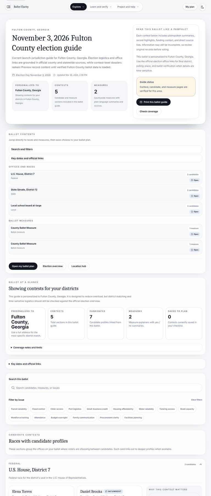
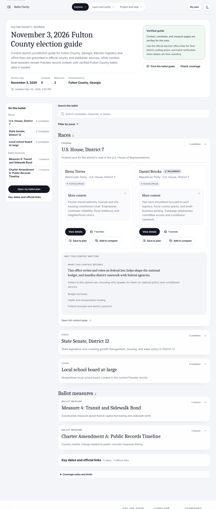
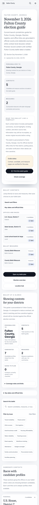
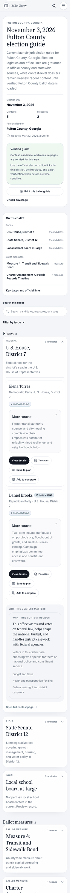
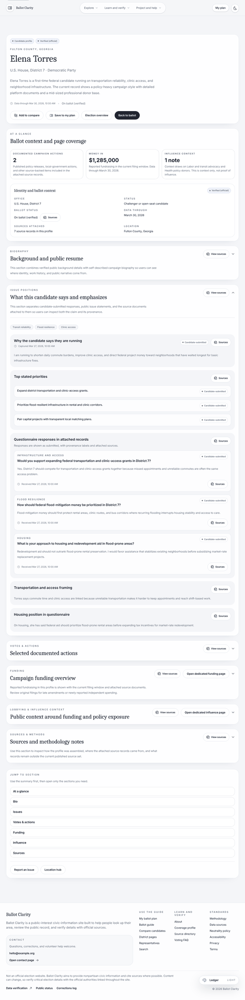
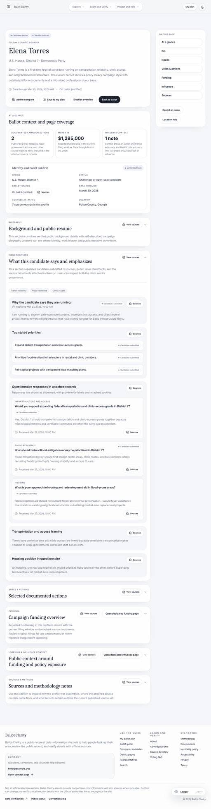
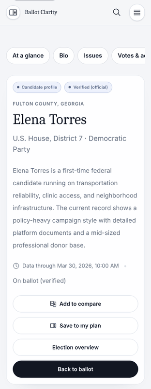
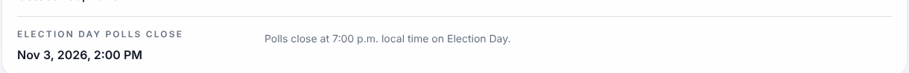

# UX, readability, and flow redesign

Audit and proposal written October 20, 2026 against `7010942` (release `v1.8.76`). Phase 1 of the redesign is on branch `claude/ux-readability-redesign`. The [September layout audit](2026-09-11-layout-and-setup.md) fixed the home and lookup entry. This document covers what a voter does next: reading the ballot, a contest, a candidate, or a measure.

> **Validation status:** The phase 1 code has **not** been built, linted, or type-checked. The audit environment could not reach the npm registry. See [Verification and limits](#verification-and-limits) for what was checked and what still has to be run before merging.

## Summary

The site's content and neutrality posture are strong. The reading experience works against them:

1. **The ballot is buried.** On a phone, the first race on the ballot page starts **4,795 px** down, about 5.7 screens. Before it come a hero with three stat cards, a reading note, a contents list, a second set of five stat cards repeating the first, coverage notes, key dates, and 17 issue-filter chips.
2. **Navigation lands at the bottom on most screens.** Candidate, measure, and representative pages only switch to two columns at 1536 px. The sticky sidebar expected 1280 px. Below 1536 px, which covers most laptops and every phone, the "Jump to section" navigation and breadcrumbs render **after** the full page.
3. **Most of the text is small and grey.** On the ballot page, 346 of the 354 visible paragraphs are 14 px or smaller, and 300 of them use the secondary grey `#657080`. That color has 4.6:1 contrast on the page background, barely above the AA minimum. The same page has 109 all-caps, widely tracked labels and cards nested five levels deep.
4. **The same status is said four times.** "Contest, candidate, and measure pages are still under local review" appears in the hero, a callout, the stat cards, and the coverage notes. A verified guide still shows its status in an amber warning box.
5. **A wrong polls-close time.** "Election Day polls close" displays **2:00 PM** for Eastern visitors while its note says 7:00 p.m. Phase 1 fixes it.

Phase 1 changes:

| Metric | Before | After phase 1 |
| --- | --- | --- |
| First race on ballot page, phone (390 px) | 4,795 px (5.7 screens) | 1,845 px (2.2 screens) |
| First race on ballot page, laptop (1280 px) | 2,775 px | 815 px, at the fold |
| Ballot page length, laptop | 5,012 px | 3,455 px |
| Light-mode secondary text contrast (Ledger) | 4.6:1 | 6.7:1 on page background, 7.3:1 on panels |
| Smallest explanatory paragraph size | 12 px | 14 px (15.6 px for former 14 px copy) |
| Candidate page section navigation, 1280 px | Bottom of page | Sticky sidebar |
| Candidate page section navigation, phone | Bottom of page | Chip row at the top |

## How this was audited

- **What was run:** The released `v1.8.76` runtime artifact (API and Nuxt output), on the bundled seed snapshot. The snapshot's preview contest, candidate, and measure records were relabeled so the full guide renders. This is preview data, not a coverage claim.
- **Screen sizes:** Every public route was captured at 1280 × 800 and 390 × 844, light theme, `America/New_York` time zone.
- **Measurements:** A Playwright script recorded paragraph size and color, interactive control counts, all-caps label counts, card nesting depth, and the position of the first contest.
- **After screenshots:** These apply the branch's actual CSS to the released pages. The edited Vue templates (`ElectionHero`, `BallotLogisticsPanel`, the ballot page script and template, and `ContestSection`) were server-rendered with Vue's runtime compiler against the same API response, then placed into the page. Unchanged child components, such as candidate cards, are the released markup.

## Findings

### F1. The ballot page puts summary before substance (high)

The ballot page stacks, in order: the hero (three stat cards plus a side panel with two paragraphs, a callout, and two buttons), "Ballot contents", "Ballot at a glance" (five stat cards, three of them repeating the hero), coverage notes, key dates, search, 17 filter chips, and an intro panel for "Races with candidate profiles". The "Ballot contents" list was meant to be a sticky sidebar, but that only happens at ≥1536 px. Below that width it is about 1,000 px of navigation stacked above everything else.

The two measures were both listed as **"County Ballot Measure"**, because the contents list and the contest headings used the shared office label instead of the measure title.

| Before (1280 px) | After phase 1 |
| --- | --- |
|  |  |

| Phone before | Phone after |
| --- | --- |
|  |  |

### F2. Detail-page navigation renders after the content (high)

`candidate/[slug]`, `measure/[slug]`, and `representatives/[slug]` used `2xl:grid-cols-[…]` (1536 px) for the grid but `xl:sticky` (1280 px) for the aside. Below 1536 px the aside, which holds the breadcrumbs, the section list, "Report an issue", and the location link, falls to the end of a page that is 5,000–10,500 px long. A voter on a phone never sees it.

| Candidate page before (1280 px; navigation at the bottom) | After |
| --- | --- |
|  |  |

On a phone, the section links now sit at the top as a scrollable chip row:



### F3. Reading text is small, low-contrast, and over-boxed (high)

- **Text size:** Body text is set to 16–18 px in `main.css`. Templates then override almost every explanatory paragraph with `text-xs` (12 px) or `text-sm` (14 px).
- **Text color:** `--app-muted` (`#657080`) is the color for most of that text. It has 4.6:1 contrast on `#f4f5f8`, the minimum for AA. For dense civic reading, 7:1 is the better target.
- **All-caps labels:** Small labels use 0.18–0.24 em letter-spacing. Some of the longer ones wrap onto three lines in phone-width cards.
- **Nested cards:** Cards sit inside cards inside cards, up to five levels on the ballot page and four on a contest page. Each level adds a border, a radius, and padding, which shrinks the reading column, most noticeably on phones.
- **Line length:** Some paragraphs in wide panels run well past 100 characters per line, for example questionnaire answers on the candidate page.

### F4. Status and meta-copy repeat (medium)

Many sections open with a sentence that describes the section rather than its content, for example "This section combines verified public background details with self-described campaign biography so users can see where identity, work history, and public narrative come from." Guide status is repeated in three to four places per page. A verified guide still shows "Guide status" in the amber warning style.

### F5. Too many equal-weight actions (medium)

- **Candidate page:** It has 16 "Sources" buttons. The hero has four equal pills; the only dark (primary) one is "Back to ballot".
- **Measure page:** "Mark YES / Review later / Mark NO" are styled the same as navigation.
- **Compare page:** "Clear compare list" is the primary (dark) button, so the destructive action gets the most emphasis.

### F6. Header hides every destination (medium)

The header has three dropdowns ("Explore", "Learn and verify", "Project and help") plus one context button. No destination is reachable in one click except that button, and "My ballot" is inside a menu.

### F7. Election Day polls-close time is wrong (high, data)

The key date `2026-11-03T19:00:00.000Z` renders as 2:00 PM in Eastern time. Daylight saving ends November 1, so EST is UTC−5. The note on the same row says 7:00 p.m. The value is in `back-end/src/coverage-data.ts`, the seed snapshot, and the **reviewed** Fulton official-logistics-only snapshot.



## Redesign direction

The target reads like a well-typeset sample-ballot pamphlet: one column of real content, a quiet table of contents, and sources available but not shouting.

### Principles

1. **The ballot comes first.** Every guide page shows the first piece of real content (a contest, a candidate's summary, a measure's YES/NO meaning) within the first screen on a laptop and the second on a phone.
2. **Say status once.** Each page gets one status line, color-coded: verified in green, under review in amber, unofficial in grey. Detail goes in a disclosure.
3. **One card level.** Pages are made of sections. Inside a section, items are separated by dividers, not boxes.
4. **Readable defaults.** Reading text is 16–18 px at 7:1 contrast with lines of 60–75 characters. Labels use sentence case or 0.08 em tracking.
5. **Navigation is visible where you are.** Breadcrumbs (Ballot › Contest › Candidate) and an "On this page" list appear at the top on phones and in a sticky sidebar from 1280 px. Each contest ends with a link to the next contest.
6. **Sources as citations.** Each section gets one sources control, plus small numbered citation chips inline, instead of a full button per claim.
7. **One primary action per view.** Save, compare, and print are secondary. Destructive actions are quiet text buttons.

### Information architecture

```
Home (lookup) ──► Results (your districts + representatives)
                      │
                      ▼
            Ballot  ──► Contest ──► Candidate ──► Compare
              │   └────► Measure
              ▼
            My plan (print / take to the polls)

Reference (footer + one "About the data" menu): Methodology · Sources · Coverage · Neutrality · Corrections · Help
```

- **Header:** Show `My ballot`, `Key dates`, and `Search` directly. Fold "Learn and verify" and "Project and help" into a single "About the data" menu. Keep the theme toggle.
- **Results and election overview:** Make these a single "Your ballot" landing when a verified guide exists. Keep them separate only when the guide is logistics-only.

### Page blueprints

- **Ballot** (phase 1 implemented the core):
  1. Compact hero (title, facts row, one status callout).
  2. An "On this ballot" contents list.
  3. Search with the filters collapsed.
  4. Contests in ballot order.
  5. Key dates and coverage notes after the contests.

  Next steps: a sticky phone footer showing "2 of 5 saved · Open my plan", and a "Next contest" link at the end of each contest.
- **Contest:** Start with "What this office does" in two sentences, then the candidates as rows: name, party, incumbent marker, a one-line summary, and Compare / Save. Move the role guide below the candidates.
- **Candidate:**
  1. Header with name, office, party, ballot status, and data-through date. Primary action: **Save to my plan**.
  2. "In brief": three bullets taken from the summary and stated priorities.
  3. Sections: Positions · Record · Money · Background · Sources. Each opens with content, not a description of the section.
  4. Questionnaire answers as a question-and-answer list with one provenance tag per block.
- **Measure:**
  1. Title.
  2. The **YES means / NO means** pair, side by side, directly under the title.
  3. Plain-language summary.
  4. Official text in a disclosure.
  5. Current law against the proposed change.
  6. Fiscal note, arguments (attributed), and sources.

  Mark YES / Review later / Mark NO becomes a single segmented control.
- **Compare:** Keep it. It is the strongest page. Demote "Clear compare list", pin the candidate names while scrolling, and default "Show only rows with meaningful differences" to on when more than eight rows are shown.
- **Plan:** Lead with the saved choices. Without a published guide, show one sentence and a link back, not a hero and three panels.

### Design system changes

| Token or component | Current | Proposed |
| --- | --- | --- |
| Reading text | 12–14 px utilities on most copy | 16 px minimum on phones, 17–18 px on desktop (`--app-font-body`); 15 px minimum for secondary text |
| Secondary text color | `#657080` (4.6:1) | `#4d5767` (6.7–7.3:1), done in phase 1; matching values for Foundry and Ember |
| Labels | 12 px, 0.18–0.24 em tracking, all caps | 13 px, sentence case (phase 2); 0.08 em tracking as a stopgap in phase 1 |
| Surfaces | `surface-panel` / `surface-row` / `surface-inset` nested freely | `section` (one bordered level), `row` (divider), `inset` (tinted, no border); lint against nesting |
| Status | `InfoCallout` info / warning | Adds a success tone (phase 1). Proposed `StatusLine` component: icon, one sentence, "Details" disclosure |
| Sources | Pill "Sources" button per block | One `SourcesButton` per section plus inline `[1]` citation chips that open the source drawer |
| Section navigation | Vertical card list, rendered last below 1536 px | Phase 1: sticky sidebar from 1280 px, chip row below. Phase 2: add scroll-spy |

## Phase 1: changes on this branch

| Commit | Change |
| --- | --- |
| Correct Fulton Election Day polls-close timestamp | Changes `2026-11-03T19:00Z` to `2026-11-04T00:00Z` in the seed source and both snapshots, with a regression test (`back-end/test/election-key-dates.test.ts`). **The reviewed snapshot was edited in place, so re-review it before promoting.** |
| Add readability layer | Raises secondary-text contrast in all three light themes, sets reading-size floors and a 72-character line limit, tightens label tracking, flattens nested cards, stops summary stats overflowing on phones, and adds a success callout tone. All of this is in `main.css` and `theme-schemes.ts`. |
| Put contests first on the ballot page | Rewrites `ElectionHero`. Adds `BallotLogisticsPanel` (key dates and official links, moved below the contests). Adds a sticky "On this ballot" contents list from 1280 px and collapses the issue filters. Removes the duplicate stat cards. Uses measure titles in place of "County Ballot Measure". Makes contest sections size to their column. |
| Show page navigation beside or above detail pages | Adds a shared `detail-layout` for candidate, measure, and representative pages. Below 1280 px the section navigation becomes a chip row at the top. Renames "Jump to section" to "On this page" and drops its meta description. |

Copy kept on purpose: the logistics-only ballot view still contains "Official links are live for this area", "Key dates and official links", and "Verified contest pages pending". It still omits "Ballot contents" and "Recent updates", as `test/e2e-smoke.test.ts` expects.

## Phase 2 and 3 roadmap

**Phase 2: components (about 1–2 weeks)**

- `StatusLine` replaces repeated guide-status copy on ballot, election, contest, candidate, measure, and plan pages.
- `SourcesButton` plus citation chips. This cuts the candidate page from 16 to about 5 source controls.
- A sentence-case label component replaces the `text-xs tracking-[0.2em] uppercase` pattern (262 instances in `src`).
- Remove meta-description sentences from section headers.
- Header IA change (F6).
- Candidate and measure page reorder (blueprints above). The measure YES/NO pair goes to the top.

**Phase 3: flow (about 2 weeks)**

- Merge "Your ballot" with results when a verified guide exists.
- "Next contest" and "Previous contest" paging, plus a sticky phone plan footer.
- Scroll-spy on "On this page".
- Run usability tests with five or more voters on phones (task: "Find what a YES vote on Measure 4 means and save it to your plan"). Track time-to-first-contest, plan saves per session, and compare usage.

## Verification and limits

**What ran in the audit environment** (Node 22.22; the npm registry and nodejs.org were unreachable):

- **Vue syntax:** Every edited `.vue` file compiles with `@vue/compiler-dom` 3.5.43 (template) and TypeScript `transpileModule` (script). This is syntax only, not type checking.
- **Back-end tests:** The suite was bundled with esbuild and run against the release's production dependencies. Result: 222 pass, 3 fail, plus the server-lifecycle file. The same tests fail on unchanged `main` in this environment. The new key-date test fails on `main` (shows 2:00 PM) and passes on the branch.
- **Front-end tests:** Run with Node's built-in type stripping, 121 pass and 13 fail. The same 13 fail on unchanged `main`; they need `tsx` and Nuxt. Bundling those 13 with esbuild ran 38 tests, of which 36 pass. The 2 failures are environment-related.
- **Rendering:** The edited ballot templates were server-rendered against the live API response for both the verified-guide and the logistics-only states.

**Not run, and required before merging:**

```bash
nvm use && npm ci
npm run lint            # or npm run lint-fix first; antfu style may reflow edited templates
npm run typecheck
npm run build
npm run test:unit
npm run test:e2e
npm run a11y
npm run start:local     # check /ballot/<slug>, /candidate/<slug>, /measure/<slug>, /representatives/<slug> at 390, 768, 1280, 1536 px, light and dark
```

**Known risks:**

- **New CSS-only classes:** The hero, contents list, and layout classes are plain CSS in `main.css`, so they do not depend on UnoCSS generation.
- **New utility classes:** Templates use a few utilities that the released build did not contain, such as `space-y-5`. UnoCSS generates them at build time.
- **Dark mode:** It was not screenshotted.
- **Production data:** The production snapshot may differ from the reviewed file in the repository. Check its polls-close value separately.
